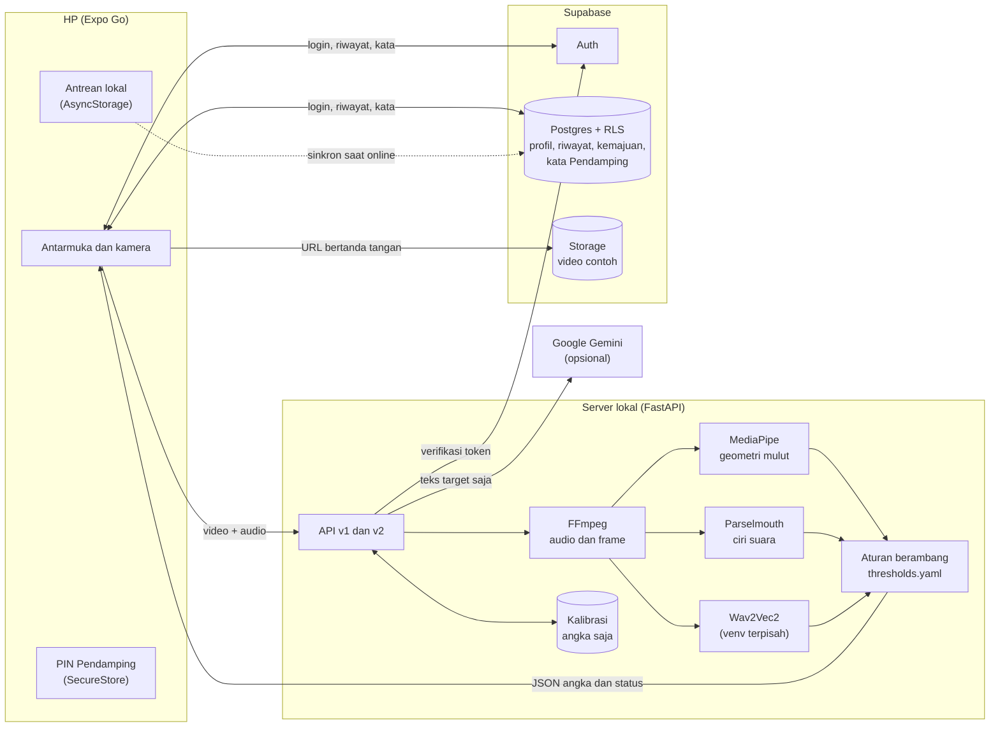

# Rekan Wicara

Aplikasi seluler untuk latihan pelafalan bagi teman Tuli dan tunarungu yang memilih berlatih bicara.
Pengguna merekam video wajah dan suara selama 2–3 detik. Aplikasi menampilkan dua indikator,
**Bibir** dan **Suara**, beserta satu petunjuk yang bisa langsung dicoba lagi. Semua umpan balik
bersifat visual (warna, ikon, teks) dengan getar sebagai pelengkap. Tidak ada isyarat yang hanya berupa bunyi.

| | |
|---|---|
| **Kategori** | Mobile (React Native / Expo) dengan server analisis FastAPI |
| **Nama aplikasi** | Rekan Wicara |
| **Lomba** | LOGICODIX 2026, subtema Inclusive Health |
| **Repositori** | https://github.com/ricoaldy-e/rekanwicara |

> **Batas produk.** Rekan Wicara adalah alat bantu latihan. Aplikasi ini bukan alat diagnosis,
> bukan terapi, dan tidak menggantikan terapis wicara atau guru. Hasilnya adalah perkiraan sistem
> untuk latihan, bukan penilaian klinis.

## Daftar isi

1. [Tim dan pembagian tugas](#1-tim-dan-pembagian-tugas)
2. [Latar belakang dan target pengguna](#2-latar-belakang-dan-target-pengguna)
3. [Solusi dan fitur utama](#3-solusi-dan-fitur-utama)
4. [Teknologi](#4-teknologi)
5. [Arsitektur dan alur data](#5-arsitektur-dan-alur-data)
6. [Instalasi lokal](#6-instalasi-lokal)
7. [Variabel lingkungan](#7-variabel-lingkungan)
8. [Akun demonstrasi](#8-akun-demonstrasi)
9. [Pengujian](#9-pengujian)
10. [Hasil dan keterbatasan](#10-hasil-dan-keterbatasan)
11. [Dokumentasi penggunaan AI](#11-dokumentasi-penggunaan-ai)
12. [Atribusi pihak ketiga](#12-atribusi-pihak-ketiga)
13. [Struktur repositori dan dokumen](#13-struktur-repositori-dan-dokumen)
14. [Lisensi](#14-lisensi)

## 1. Tim dan pembagian tugas

| Anggota | Peran | Tanggung jawab |
|---|---|---|
| Rico Aldy Kusuma | Frontend dan pipeline penilaian | Desain antarmuka (Figma) dan implementasinya di aplikasi Expo; sistem desain dan aksesibilitas; pipeline penilaian bibir dan suara (landmark bibir, fitur akustik, kalibrasi, segmentasi, aturan berambang, petunjuk); alat dataset, penyetelan ambang, dan evaluasi; integrasi frontend dengan API v2; dokumentasi |
| Steven Jonathan Sihombing | Backend dan data | API v2 (katalog, penilaian, instruksi); autentikasi dan penghapusan akun; persistensi Supabase beserta RLS; kata Pendamping (CRUD); video contoh di Storage; integrasi Wav2Vec2 dan pembuat instruksi berbasis LLM |
| Muhammad Helmi Abdulbaqi | Fondasi aplikasi dan media | Kerangka awal aplikasi Expo; komponen rekam video+audio dan unggah; alat pengumpulan dataset tim; pipeline media awal (FFmpeg, pemeriksaan kualitas rekaman, ekstraksi fitur wajah) |

Pembagian di atas mengikuti riwayat commit (`git shortlog`). Pekerjaan lintas peran, seperti pengambilan data rekaman dan
pelabelan silang, dilakukan bersama oleh ketiga anggota.

Urutan pengerjaan:

1. **10 November** — kerangka aplikasi, pipeline media, pemeriksaan kualitas, komponen rekam, alat dataset.
2. **10–11 November** — pengambilan 81 klip dataset tim, pelabelan silang, penyetelan ambang, evaluasi (EVAL_REPORT).
3. **11–12 November** — integrasi HP, sinkronisasi Supabase, inventaris pihak ketiga, pemeriksaan submission.
4. **13 November** — autentikasi email/password, eksperimen Wav2Vec2, API v2, kata Pendamping.
5. **14 November** — implementasi desain Figma, Level 1 vokal a/i/u/e/o dengan penilaian v2, katalog Kata Penting, penyatuan cabang frontend dan backend.

## 2. Latar belakang dan target pengguna

Sebagian teman Tuli dan tunarungu memilih berlatih bicara, misalnya untuk berkomunikasi dalam situasi darurat.
Latihan yang lazim bergantung pada umpan balik pendengaran: guru atau terapis mengatakan apakah bunyi sudah
tepat, dan pengguna membandingkan bunyi yang ia dengar. Di antara pertemuan, pengguna berlatih tanpa umpan balik
yang bisa ia amati sendiri. Terapis wicara juga tidak tersedia merata.

Rekan Wicara mengganti umpan balik pendengaran dengan umpan balik visual yang bisa diamati sendiri: bentuk bibir
dibandingkan dengan bentuk target, dan ciri suara ditampilkan sebagai grafik dan status.

**Target pengguna**

- Teman Tuli dan tunarungu yang **memilih** berlatih bicara, berlatih mandiri di antara pertemuan dengan guru atau terapis.
- Pendamping (keluarga, guru) yang menyiapkan kata latihan dan mengatur akun serta PIN.

**Kontribusi terhadap Inclusive Health.** Aplikasi menyediakan latihan berulang, murah, dan bisa dilakukan di rumah. Aplikasi
tidak mengklaim menggantikan tenaga profesional dan tidak memberi diagnosis.

## 3. Solusi dan fitur utama

- **Latihan empat langkah.** Lihat contoh, Tiru (rekam), Menganalisis, Hasil. Satu instruksi per layar, teks pendek.
- **Level 1: vokal a, i, u, e, o.** Dinilai dari bentuk bibir (MediaPipe), ciri suara (Parselmouth/Praat), dan bunyi yang terucap (Wav2Vec2).
- **Level 2 dan 3: Kata Penting.** Delapan kata sehari-hari (TOLONG, POLISI, API, SAKIT, OBAT, ALAMAT, MAKAN, HAUS) beserta suku katanya.
  Ucapan dikenali Wav2Vec2 dan dibandingkan dengan teks target.
- **Dua indikator terpisah dan tiga status.** *Sesuai*, *Mendekati* (hanya Level 1), *Belum sesuai*. Tanpa skor angka. Status selalu warna + ikon + teks.
- **Hasil yang bisa dibandingkan.** Level 1 menampilkan "Cermin bibir" (bentuk target dan milik pengguna pada grafik yang sama), "Peta vokal", dan grafik kekerasan suara.
- **Instruksi bertahap.** Cara mengucapkan dipecah menjadi langkah pendek, satu kartu per langkah, dengan video contoh.
- **Mode Pendamping.** Setelah memasukkan PIN, pendamping menambah, mengubah, dan menghapus kata latihan sendiri (video, instruksi, suku kata). Instruksi bisa disarankan oleh LLM lalu diedit.
- **Kalibrasi.** Posisi bibir diam dan vokal a, i, u direkam sekali agar penilaian menyesuaikan wajah pengguna.
- **Akun dan kemajuan.** Masuk dengan email dan kata sandi; riwayat dan kemajuan numerik tersimpan di Supabase, antrean lokal menahan data saat koneksi putus.
- **Aksesibilitas sebagai syarat.** Teks ≥ 15, target sentuh ≥ 48 dp, kontras diukur, mengikuti pengaturan Reduce Motion, tidak ada bunyi beep, getar bisa dimatikan.
- **Privasi.** Rekaman latihan dihapus segera setelah dianalisis, termasuk saat galat. Log hanya berisi angka dan kode status. Wajah hanya dipakai untuk geometri mulut; tidak ada pengenalan identitas.

## 4. Teknologi

| Lapisan | Teknologi |
|---|---|
| Aplikasi | React Native 0.88, Expo SDK 58 (Expo Go), TypeScript strict, expo-router, expo-camera, expo-video, react-native-svg, expo-haptics, expo-secure-store |
| Server | Python 3.11, FastAPI, Uvicorn, Pydantic, NumPy, SciPy, SoundFile |
| Analisis wajah | MediaPipe Face Landmarker (Tasks API) |
| Analisis suara | praat-parselmouth (Praat) |
| Pengenalan ucapan | Wav2Vec2 (Hugging Face Transformers, PyTorch CPU) di venv terpisah |
| Media | FFmpeg dan ffprobe |
| Data dan akun | Supabase: Auth (email/password), Postgres dengan RLS, Storage (video contoh) |
| Pengujian dan mutu | pytest, Ruff, Jest, Testing Library, ESLint, TypeScript |
| Desain | Figma; font Inter dan Playfair Display |

## 5. Arsitektur dan alur data



**Alur satu latihan**

1. HP merekam video+audio 2–3 detik dan mengirimnya ke `POST /v2/analyze` bersama token akun.
2. Server memverifikasi token, menyimpan rekaman ke direktori sementara, lalu FFmpeg mengambil audio WAV 16 kHz dan frame.
3. Pemeriksaan kualitas (wajah terlihat, ada suara, durasi). Bila gagal, respons `retry` dengan petunjuk.
4. MediaPipe menghitung kontur dan bukaan bibir; Parselmouth menghitung intensitas, nada, dan formant; Wav2Vec2 menuliskan ucapan.
5. Aturan berambang (ambang di `server/app/config/thresholds.yaml`, disesuaikan dengan kalibrasi pengguna) menghasilkan status Bibir, Suara, dan satu petunjuk.
6. Rekaman dihapus. Server mengembalikan JSON berisi angka, status, dan data grafik.
7. Aplikasi menampilkan hasil dan menyimpan riwayat (hanya angka dan status) ke Supabase, atau ke antrean lokal bila offline.

**Data yang disimpan**

| Data | Lokasi | Catatan |
|---|---|---|
| Rekaman latihan | tidak disimpan | dihapus setelah analisis, termasuk saat galat |
| Angka kalibrasi | `DATA_DIR/calibration` di server | angka saja |
| Profil, riwayat, kemajuan | Supabase Postgres | RLS per `auth.uid()`; hanya angka dan status |
| Kata dan video Pendamping | Supabase Postgres dan Storage | terikat pemilik akun |
| PIN Pendamping | SecureStore di HP | tidak dikirim ke server |
| Dataset pengembangan | `data/` lokal | persetujuan tertulis penutur, tidak di-commit, tidak diunggah ke cloud publik |

## 6. Instalasi lokal

### Prasyarat

Git, Python 3.11, FFmpeg dan ffprobe di `PATH`, Node.js 22.13 atau lebih baru, serta HP dengan Expo Go
untuk SDK 58. HP dan laptop harus berada di jaringan yang sama. Perintah di bawah memakai PowerShell;
`npm.cmd` dan `npx.cmd` menghindari blokir skrip `.ps1`.

```powershell
py -3.11 --version
ffmpeg -version
ffprobe -version
node --version
```

### Server

```powershell
cd server
py -3.11 -m venv .venv
.venv/Scripts/python.exe -m pip install -r requirements.txt
if (!(Test-Path .env)) { Copy-Item .env.example .env }
.venv/Scripts/python.exe scripts/download_models.py
```

Skrip terakhir mengunduh model Face Landmarker (tidak ada di Git). SHA-256 unduhan yang diuji:
`64184e229b263107bc2b804c6625db1341ff2bb731874b0bcc2fe6544e0bc9ff`. Bandingkan dengan keluaran skrip karena URL
sumber memakai `latest`.

### Wav2Vec2 (venv terpisah)

Penilaian Level 1 dan Kata Penting memerlukan Wav2Vec2. Lingkungan ini terpisah dari `server/.venv`
dan **tidak boleh** dipasang ke dalamnya. Dari root repositori:

```powershell
py -3.11 -m venv ml/wav2vec2/.venv
ml/wav2vec2/.venv/Scripts/python.exe -m pip install -r ml/requirements-wav2vec2.txt
ml/wav2vec2/.venv/Scripts/python.exe -B ml/tools/download_wav2vec2.py
```

Unduhan berukuran sekitar 1,2 GB dan diverifikasi dengan SHA-256. Setelah itu inferensi berjalan offline di CPU.
Tanpa langkah ini server mengembalikan galat `wav2vec2_unavailable` untuk penilaian v2.

### Server: menjalankan

```powershell
cd server
.venv/Scripts/python.exe -m uvicorn app.main:app --host 0.0.0.0 --port 8000 --no-access-log
```

Buka `http://<IP-laptop>:8000/v1/health` dari browser HP. Respons harus berupa JSON dengan `mock_mode: false`.
IPv4 Wi-Fi laptop dilihat dengan `ipconfig`. Variabel shell mengalahkan `.env`, jadi pastikan terminal tidak
mewarisi `DEBUG` atau `MOCK_MODE` dari sesi lain.

### Supabase

1. Buat proyek Supabase dan aktifkan penyedia **Email**.
2. Jalankan [docs/supabase/schema.sql](docs/supabase/schema.sql) di SQL Editor. Tabel kata Pendamping memakai
   [custom_words_manual.proposed.sql](docs/supabase/custom_words_manual.proposed.sql) dan kebijakan baca video bawaan
   memakai [tutorial_default_read_policy.proposed.sql](docs/supabase/tutorial_default_read_policy.proposed.sql).
3. Buat bucket privat `rekan-wicara-tutorials` dan unggah video contoh dengan path `default/...`
   (lihat [docs/SPEC.md](docs/SPEC.md) §5 dan [docs/supabase/AUTH.md](docs/supabase/AUTH.md)).
4. Isi URL dan anon key di `app/.env` serta `server/.env`. Service-role key hanya boleh ada di `server/.env`.

### Aplikasi

```powershell
cd app
npm.cmd ci
if (!(Test-Path .env)) { Copy-Item .env.example .env }
npx.cmd expo login --no-browser
npx.cmd expo start -c --lan --go
```

Isi `app/.env` (lihat bagian 7), masuk ke akun Expo yang sama di CLI dan Expo Go, lalu pindai QR atau buka
`exp://<IP-laptop>:8081`. Izinkan kamera, mikrofon, dan jaringan lokal. Jalankan Metro dengan `-c` setiap kali
`.env` berubah. Jika koneksi gagal, periksa IP terbaru dan izin Windows Firewall untuk port 8000 dan 8081
(izinkan jaringan Private; jangan mematikan firewall).

## 7. Variabel lingkungan

Contoh lengkap dengan komentar ada di [app/.env.example](app/.env.example) dan [server/.env.example](server/.env.example).
Berkas `.env` tidak di-commit.

### `app/.env`

Semua variabel `EXPO_PUBLIC_*` ikut terbundel ke aplikasi, jadi hanya nilai publik yang boleh diisi.

| Variabel | Bawaan | Keterangan |
|---|---|---|
| `EXPO_PUBLIC_API_URL` | – | Alamat server di jaringan lokal, `http://<IP-laptop>:8000` |
| `EXPO_PUBLIC_SUPABASE_URL` | kosong | URL proyek Supabase |
| `EXPO_PUBLIC_SUPABASE_ANON_KEY` | kosong | Anon/publishable key. Dibatasi RLS. Jangan isi service-role key |
| `EXPO_PUBLIC_USE_MOCK` | `false` | `true`: katalog, akun, dan kata Pendamping dari data contoh di aplikasi. Token tiruan ditolak `/v2/analyze`, jadi pasangkan dengan `EXPO_PUBLIC_ANALYZE_API=mock` |
| `EXPO_PUBLIC_ANALYZE_API` | `v2` | `v2` memakai `/v2/analyze`; `mock` mengembalikan hasil contoh. `v1` tidak lagi dipakai |

### `server/.env`

| Variabel | Bawaan | Keterangan |
|---|---|---|
| `HOST`, `PORT` | `0.0.0.0`, `8000` | Alamat dan port. `0.0.0.0` agar HP di Wi-Fi yang sama bisa menjangkau laptop |
| `MOCK_MODE` | `false` | `true`: `/v1/analyze` dan `/v1/calibrate` mengembalikan contoh tanpa analisis |
| `DATASET_MODE` | `false` | `true`: membuka `POST /v1/dataset/upload` untuk sesi perekaman dataset |
| `DEBUG` | `false` | `true`: membuka endpoint debug dan eksperimen. Jangan aktif saat demo |
| `DATA_DIR` | `../data` | Folder data lokal (kalibrasi, dataset), relatif terhadap `server/` |
| `SCORER_MODE` | `rules` | Satu-satunya nilai yang diterima. Wav2Vec2 tidak diatur lewat variabel ini |
| `ENGINE_VERSION` | `0.1.0` | Versi mesin pada respons dan riwayat |
| `MAX_UPLOAD_MB` | `15` | Batas ukuran unggahan |
| `FACE_MODEL_PATH` | `models/face_landmarker.task` | Model MediaPipe, relatif terhadap `server/` |
| `TMP_DIR` | kosong | Folder sementara per permintaan. Kosong memakai temp sistem. Selalu dihapus |
| `SUPABASE_URL` | kosong | URL HTTPS proyek. Wajib untuk endpoint v2 |
| `SUPABASE_ANON_KEY` | kosong | Dipakai server bersama JWT pemanggil agar RLS tetap berlaku |
| `SUPABASE_SERVICE_ROLE_KEY` | kosong | Hanya untuk penghapusan akun dan unggah video tim. Jangan taruh di aplikasi |
| `TUTORIAL_UPLOADER_IDS` | `[]` | Larik JSON UUID akun perekam tim. Kosong menolak semua akses produksi tutorial |
| `LLM_API_URL`, `LLM_API_KEY`, `LLM_MODEL` | kosong | Gemini lewat endpoint kompatibel Chat Completions untuk tombol "Buat dengan AI"; URL, kunci, dan nama model dari Google AI Studio. Kosong membuat endpoint mengembalikan `AI_UNAVAILABLE`; fitur lain tidak terpengaruh |

## 8. Akun demonstrasi

Aplikasi mewajibkan masuk akun. Tidak ada kredensial bersama yang ditanam di repositori. Ada dua cara mencoba:

**a. Mode contoh (tanpa Supabase dan tanpa Wav2Vec2).** Isi `app/.env`:

```dotenv
EXPO_PUBLIC_USE_MOCK=true
EXPO_PUBLIC_ANALYZE_API=mock
```

Kalibrasi tetap memanggil server, jadi jalankan server dengan `MOCK_MODE=true` di `server/.env`. Di layar Masuk
atau Daftar, gunakan email apa pun dan kata sandi apa pun, misalnya `demo@contoh.id`. Kata sandi tidak disimpan. Buat PIN Pendamping empat angka (`1234` ditolak; pakai misalnya `2580`). Hasil latihan berlabel contoh dan
bukan penilaian sungguhan. Email khusus untuk menguji galat: `salah@contoh.id` (kredensial salah), `dipakai@contoh.id`
(email terdaftar, saat daftar), `cek@contoh.id` (layar Cek email), `mati@contoh.id` (tanpa koneksi).

**b. Penilaian sungguhan.** Siapkan Supabase (bagian 6), lalu daftar lewat layar **Buat akun** dengan email milik sendiri.
Bila konfirmasi email aktif, buka tautan di email sebelum masuk. Isi `EXPO_PUBLIC_USE_MOCK=false` dan
`EXPO_PUBLIC_ANALYZE_API=v2`.

## 9. Pengujian

```powershell
# dari server/
.venv/Scripts/python.exe -m pytest -q
.venv/Scripts/python.exe -m ruff check app tests ../ml
.venv/Scripts/python.exe -m ruff format --check app tests ../ml

# dari app/
npm.cmd test
npm.cmd run typecheck
npx.cmd expo lint
```

Tes ML berjalan di pytest server dengan data sintetis. Dataset rekaman tidak diperlukan untuk menjalankan aplikasi
maupun tes.

## 10. Hasil dan keterbatasan

Evaluasi *leave-one-speaker-out* untuk penilai berbasis aturan (bibir dan suara), 81 klip dari 3 anggota tim,
seluruhnya iPhone di satu ruangan:

| Pengukuran | Hasil | Target |
|---|---|---|
| Bibir rapat | 56/60 (93%) | ≥ 90% |
| Suara saat bibir rapat | 43/50 (86%) | ≥ 80% |
| Vokal a/i/u | 19/23 (83%) | ≥ 85%, belum tercapai |
| Status kata | 12/22 (55%) | ≥ 80%, belum tercapai |
| Waktu proses server (p90) | 984 ms | ≤ 5 s |

Angka ini adalah bukti awal pada penutur dewasa non-Tuli, **bukan akurasi pada pengguna sasaran**. Hal yang belum dilakukan:

- Belum diuji dengan penutur Tuli, anak-anak, atau kamera Android.
- Penilaian Wav2Vec2 (Level 1 dan Kata Penting) belum dievaluasi dengan penutur Tuli. Model berasal dari data penutur dengar, jadi
  ucapan penutur Tuli mungkin dinilai berbeda dari yang dimaksud.
- Pembedaan p/b dan penilaian kata masih lemah pada evaluasi aturan.
- Vokal e dan o ditambahkan belakangan dan belum masuk evaluasi di atas.
- Antarmuka terbaru belum diuji di perangkat untuk skala teks 200%, layar 360 dp, dan pembaca layar.
- Petunjuk, gambar bibir, dan instruksi bawaan belum ditinjau ahli terapi wicara.

Rincian ada di [EVAL_REPORT.md](docs/EVAL_REPORT.md) dan [MODEL_CARD.md](docs/MODEL_CARD.md).

## 11. Dokumentasi penggunaan AI

### 11.1 Model dan layanan AI di dalam produk

| Model / layanan | Modul yang memakainya | Fungsi | Data masuk dan keluar | Catatan |
|---|---|---|---|---|
| **MediaPipe Face Landmarker** (Google, `face_landmarker.task` float16) | `server/app/pipeline/face.py`, `lips.py`, `features.py`; ekstraksi di `media.py` | 478 titik wajah dan blendshape per frame untuk mengukur bukaan dan bentuk bibir | Frame dari rekaman (diproses lokal di server) → angka geometri | Model pralatih, tidak dilatih ulang. Apache-2.0. Tidak ada pengenalan identitas |
| **Wav2Vec2** [`Wikidepia/wav2vec2-xls-r-300m-indonesian`](https://huggingface.co/Wikidepia/wav2vec2-xls-r-300m-indonesian), revisi `8a9d507f…` | `ml/tools/wav2vec2_poc.py` (dipanggil `server/app/api/v1/wav2vec2.py`); dipakai `server/app/api/v2/analysis.py`, `vowels.py`, `server/app/pipeline/combined.py`, `text_match.py` | Mengubah ucapan menjadi teks (greedy CTC, tanpa model bahasa) untuk dibandingkan dengan teks target | Audio WAV 16 kHz (lokal, CPU) → teks | Apache-2.0. Berjalan offline di server, rekaman tidak dikirim ke Hugging Face. Bobot diverifikasi SHA-256. Tidak ada fine-tuning oleh tim. Dokumentasi: [WAV2VEC2_POC.md](docs/WAV2VEC2_POC.md) |
| **Praat melalui Parselmouth** | `server/app/pipeline/audio.py`, `features.py` | Bukan model pembelajaran mesin; algoritma pengukur intensitas, nada, dan formant | Audio → angka | GPL-3.0-or-later |
| **Google Gemini** (lewat endpoint kompatibel Chat Completions, dikonfigurasi dengan `LLM_API_URL`, `LLM_API_KEY`, `LLM_MODEL`) | `server/app/api/v2/instructions.py` (`POST /v2/instructions/generate`); tombol "Buat dengan AI" di layar kata Pendamping | Menyarankan instruksi pengucapan berbasis gerakan bibir yang bisa dilihat | Hanya teks target (kata atau suku kata) dan kata induk → teks saran | Layanan cloud Google. Tidak ada rekaman atau data pengguna yang dikirim. Saran selalu ditinjau dan bisa diedit pendamping sebelum disimpan. Prompt sistem melarang klaim medis dan kata yang dilarang produk; keluaran divalidasi server. Kunci API hanya ada di server |
| **Aturan berambang** | `server/app/pipeline/rules.py`, `hints.py`, `server/app/config/thresholds.yaml` | Menentukan status Sesuai / Mendekati / Belum sesuai dan petunjuk | Angka fitur → status | Buatan tim, bukan model AI. Ambang disetel dari data tim (3 perekam, maksimal 100 video) |

Tim tidak melatih atau menyempurnakan model apa pun. Data rekaman tim hanya dipakai untuk menyetel ambang dan menguji.

### 11.2 AI dalam proses pengembangan

Proyek ini dikembangkan dengan bantuan alat AI: **Claude Code** (Anthropic) dan **Codex** (OpenAI) untuk menulis dan meninjau kode,
tes, dan dokumentasi, serta **Claude** melalui integrasi Figma untuk menerjemahkan rancangan Figma ke komponen aplikasi.
Arah produk, batas penggunaan, desain, pengambilan data, penyetelan ambang, dan keputusan akhir ada pada tim. Hasil kerja AI
diperiksa lewat tes otomatis dan pengujian manual. Aturan kerja agen tertulis di [CLAUDE.md](CLAUDE.md) dan
[AGENTS.md](AGENTS.md); keputusan per fase dicatat di [PROGRESS.md](docs/PROGRESS.md).

Tidak ada gambar, ilustrasi, atau video yang dihasilkan AI. Logo, ikon, dan gambar bibir digambar tim di Figma.

## 12. Atribusi pihak ketiga

Daftar lengkap dengan versi, lisensi, dan tautan sumber ada di [docs/THIRD_PARTY.md](docs/THIRD_PARTY.md). Ringkasan:

| Komponen | Lisensi | Dipakai untuk |
|---|---|---|
| [MediaPipe](https://github.com/google-ai-edge/mediapipe) dan model Face Landmarker | Apache-2.0 | Landmark wajah |
| [Wav2Vec2 XLS-R 300M Indonesia](https://huggingface.co/Wikidepia/wav2vec2-xls-r-300m-indonesian) (Wikidepia), turunan dari [XLS-R](https://huggingface.co/facebook/wav2vec2-xls-r-300m) (Meta AI) | Apache-2.0 | Pengenalan ucapan |
| [Hugging Face Transformers](https://github.com/huggingface/transformers), [PyTorch](https://github.com/pytorch/pytorch) | Apache-2.0, BSD-3-Clause | Menjalankan Wav2Vec2 |
| [Parselmouth](https://github.com/YannickJadoul/Parselmouth) dan [Praat](https://www.fon.hum.uva.nl/praat/) | GPL-3.0-or-later | Analisis suara |
| [FFmpeg](https://ffmpeg.org) (binary sistem, tidak dibundel) | LGPL-2.1+ atau GPL sesuai build | Pemrosesan media |
| [FastAPI](https://github.com/fastapi/fastapi), Uvicorn, Pydantic, NumPy, SciPy, SoundFile, PyYAML, OpenCV | MIT, BSD, Apache-2.0 | Server dan numerik |
| [Google Gemini API](https://ai.google.dev/gemini-api/terms) | Layanan; tunduk pada ketentuan Google | Saran instruksi pengucapan |
| [Supabase](https://supabase.com) dan `@supabase/supabase-js` | Apache-2.0 (layanan), MIT (SDK) | Auth, database, Storage |
| [React Native](https://github.com/facebook/react-native), [Expo](https://github.com/expo/expo), expo-router, react-native-svg, dan modul Expo lain | MIT | Aplikasi |
| [@expo/vector-icons](https://github.com/expo/vector-icons) (Ionicons) | MIT untuk kode; font ikon berlisensi sendiri | Ikon antarmuka |
| [Inter](https://github.com/rsms/inter) dan [Playfair Display](https://github.com/clauswilke/PlayfairDisplay) | SIL OFL 1.1 | Font |
| Pytest, Ruff, Jest, Testing Library, ESLint, TypeScript | MIT, Apache-2.0 | Pengujian dan mutu kode |

Aset orisinal tim: logo, ikon aplikasi, dan gambar bibir (digambar di Figma, tersimpan sebagai SVG/PNG di `app/`). Video contoh
Kata Penting dan vokal direkam tim sendiri. Inspirasi tata letak (struktur dan suasana) dari karya desain publik hanya sebatas
referensi; tidak ada kode atau aset yang disalin.

## 13. Struktur repositori dan dokumen

| Folder | Isi |
|---|---|
| `app/` | Aplikasi Expo (React Native, TypeScript strict, expo-router) |
| `server/` | Server FastAPI dan pipeline analisis di `server/app/pipeline` |
| `ml/` | Skrip dataset, pelabelan, penyetelan ambang, evaluasi, dan alat Wav2Vec2; memakai ulang pipeline server |
| `docs/` | Spesifikasi, desain, kontrak, laporan evaluasi, model card, skema Supabase |
| `data/` | Data pengembangan lokal. Tidak di-commit |
| `media/` | Tempat video contoh lokal (berkas video tidak di-commit) |

Dokumen utama: [SPEC.md](docs/SPEC.md) (kontrak API di §5) · [kontrak-fe-final.md](docs/kontrak-fe-final.md) ·
[REKAN_WICARA_BE_FE_CONTRACT_V2_FINAL_DRAFT.md](REKAN_WICARA_BE_FE_CONTRACT_V2_FINAL_DRAFT.md) ·
[design.md](docs/design.md) · [flow-srs-ui.md](docs/flow-srs-ui.md) · [EVAL_REPORT.md](docs/EVAL_REPORT.md) ·
[MODEL_CARD.md](docs/MODEL_CARD.md) · [THIRD_PARTY.md](docs/THIRD_PARTY.md) · [PROGRESS.md](docs/PROGRESS.md) ·
[AUTH.md](docs/supabase/AUTH.md) · [server/README.md](server/README.md) · [app/README.md](app/README.md)

## 14. Lisensi

Kode milik tim dirilis di bawah [Lisensi MIT](LICENSE). Komponen pihak ketiga tetap memakai lisensi masing-masing,
termasuk ketentuan GPL pada Parselmouth/Praat dan lisensi build FFmpeg yang dipakai. Lisensi MIT di repositori ini
tidak menggantikannya.
